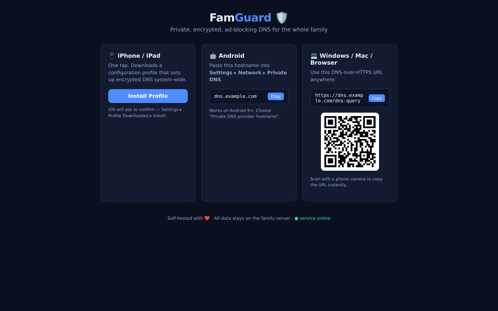

<div align="center">

# famguard

**Your own private NextDNS — a self-hosted, family-wide DNS that blocks ads, trackers, malware, and (optionally) adult content, reachable from anywhere through one encrypted Cloudflare URL.**

[](https://github.com/OneByJorah/famguard/actions/workflows/ci.yml)
[](https://www.docker.com/)
[](https://opensource.org/licenses/MIT)



</div>

## What This Is

Three pieces, one `docker compose up`:

| Piece | Job |
| ----- | --- |
| **AdGuard Home** | Filters ads, trackers, and malware for every device that points at it. Full dashboard: query logs, per-client rules, parental controls. All data stays on your server. |
| **Cloudflare Tunnel** | Exposes it to the internet **without opening a single port**. Your home IP stays hidden; traffic rides Cloudflare's encrypted edge network. |
| **Enrollment portal** | The page your family visits. One tap per device — no apps, no settings spelunking. |

## How Family Members Join (one tap)

1. Open `https://dns.yourdomain.com`
2. Pick their device:
   - **iPhone / iPad** — tap **Install Profile** → a `.mobileconfig` sets up encrypted DNS system-wide in one confirmation.
   - **Android** — copy the **Private DNS hostname** shown on the page → Settings ▸ Network ▸ Private DNS.
   - **Windows / Mac / Browser** — copy the **DoH URL** (or scan the QR code) → paste into your OS or browser DNS-over-HTTPS settings.

Done — every query from that device is now encrypted and filtered through your own server.

## Quick Start

```bash
git clone https://github.com/OneByJorah/famguard.git
cd famguard
./install.sh          # creates .env from the example and starts AdGuard + portal
```

Then:

1. Open `http://127.0.0.1:3000` — the AdGuard Home first-run wizard (set an admin password).
1. Create a free **Cloudflare Tunnel** (Zero Trust ▸ Networks ▸ Tunnels), add public hostnames:
   - `dns.yourdomain.com` → `HTTP` → `adguard:3000`  *(serves DoH **and** the portal)*
1. Put the tunnel token in `.env` (`TUNNEL_TOKEN=...`) and fill in `DOH_URL` / `PRIVATE_DNS_HOST`.
1. Go live:

```bash
docker compose --profile live up -d
```

1. Send your family the link. That's the whole deployment.

> **No ports are opened** — the tunnel is outbound-only from your server. Port 53, 80, 443 stay closed on your router.

## Parental Controls

Everything is configured in the AdGuard dashboard (`http://127.0.0.1:3000`):

- Block lists for ads/trackers/malware (built-in + add your own)
- Per-device rules and schedules (bedtime = block TikTok/YouTube)
- Optional adult-content filtering (built-in AdGuard filter)
- Query logs so you can see what's happening

## Repository Layout

```text
portal/            Enrollment portal (stdlib-only server, offline QR, .mobileconfig generator)
docker-compose.yml AdGuard + cloudflared (profile "live") + portal
install.sh         Bootstrap helper
```

## Security Notes

- No secrets in the repo. The tunnel token lives only in your local `.env` (gitignored); `.env.example` ships placeholders.
- The portal container runs as a non-root user, no dependencies, no telemetry.
- DNS queries are encrypted end-to-end to your server; Cloudflare only sees the tunnel, not your query content (DoH payload is TLS-to-your-origin).

## Requirements

- Any Docker host: VPS, Raspberry Pi 4+, home server
- A Cloudflare account (free tier is enough) and one domain on it

## Contributing

Issues and PRs welcome — see [CONTRIBUTING.md](CONTRIBUTING.md). Keep demo values fictional.

## License

MIT — see [LICENSE](LICENSE).
